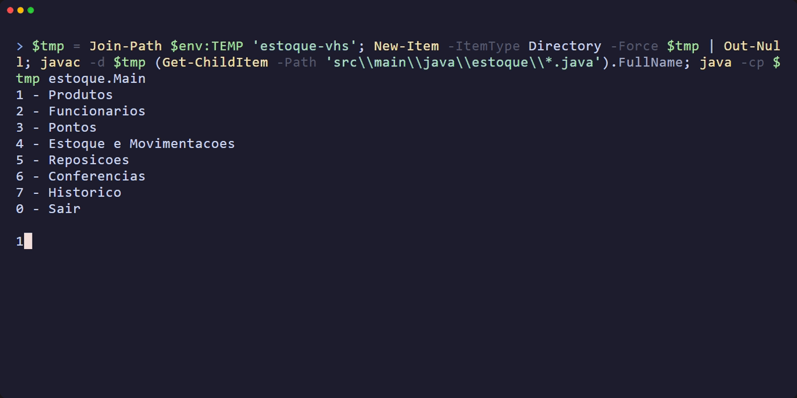

# Estoque-Console

Sistema de gerenciamento de estoque desenvolvido em Java, executado diretamente pelo terminal.

O projeto trabalha com cadastro de produtos, funcionários e pontos, além de movimentações, reposições e conferências de estoque.

<p align="center">
  
</p>

## Funcionalidades

* Cadastro de produtos
* Cadastro de funcionários
* Cadastro de pontos
* Entrada e saída de estoque
* Reposição de produtos
* Conferência de estoque
* Histórico de movimentações

## Tecnologias

* Java 17
* Programação Orientada a Objetos (POO)
* ArrayList
* Scanner

## Como executar

Clone o repositório e entre na pasta do projeto:

```bash
git clone <URL_DO_REPOSITORIO>
cd Estoque-Console
```

Compile os arquivos:

```bash
javac -d . $(find src -name "*.java")
```

Execute o programa:

```bash
java estoque.Main
```

No Windows PowerShell, caso o comando `find` não funcione, você pode usar:

```powershell
javac -d . (Get-ChildItem -Recurse -Filter *.java src).FullName
java estoque.Main
```

## Estrutura

```text
Estoque-Console/
├── src/
│   └── main/
│       └── java/
│           └── estoque/
│               ├── Main.java
│               ├── Menu.java
│               ├── Produto.java
│               ├── ProdutoService.java
│               ├── Funcionario.java
│               ├── FuncionarioService.java
│               ├── Ponto.java
│               ├── PontoService.java
│               ├── Estoque.java
│               ├── EstoqueService.java
│               ├── Movimentacao.java
│               ├── MovimentacaoService.java
│               ├── Reposicao.java
│               ├── ReposicaoService.java
│               ├── Conferencia.java
│               └── ConferenciaService.java
├── estoque-demo.gif
├── .gitignore
└── README.md
```
