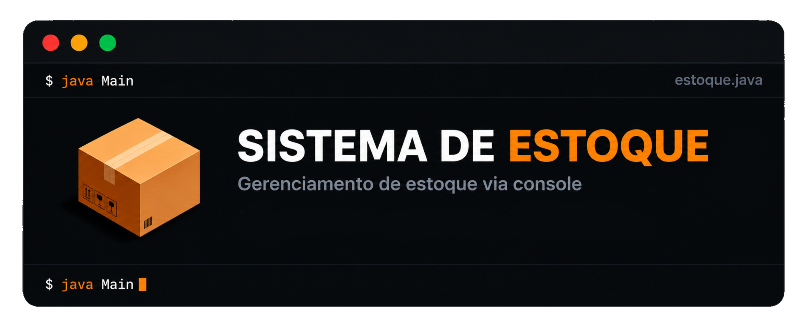

Claro. Eu deixaria **bem mais organizado**, sem exagerar em emoji, badge ou firula. O banner já faz o trabalho visual, então o resto fica limpo.

<p align="center">
  
</p>

<p align="center">
  Sistema de gerenciamento de estoque desenvolvido em <strong>Java 17</strong> para execução via terminal.
</p>

## Sobre o projeto

O **Estoque-Console** é um sistema de gerenciamento de estoque desenvolvido em **Java 17**, executado diretamente pelo terminal.

O projeto foi desenvolvido com foco na aplicação de conceitos de **Programação Orientada a Objetos (POO)** e organização de responsabilidades por meio de classes e serviços.

O sistema permite realizar o cadastro e gerenciamento de produtos, funcionários e pontos, além de controlar entradas e saídas, reposições e conferências de estoque.

## Funcionalidades

* Cadastro de produtos
* Cadastro de funcionários
* Cadastro de pontos
* Entrada de estoque
* Saída de estoque
* Consulta de estoque
* Reposição de produtos
* Conferência de estoque
* Histórico de movimentações

## Tecnologias

* **Java 17**
* **Programação Orientada a Objetos (POO)**
* **ArrayList**
* **Scanner**

## Demonstração

<p align="center">
  
</p>

## Como executar

### 1. Clone o repositório

```bash
git clone <URL_DO_REPOSITORIO>
cd Sistema-de-Estoque-em-Java
```

### 2. Compile os arquivos

No Linux/macOS ou Git Bash:

```bash
javac -d . $(find src -name "*.java")
```

No Windows PowerShell:

```powershell
javac -d . (Get-ChildItem -Recurse -Filter *.java src).FullName
```

### 3. Execute o programa

```bash
java estoque.Main
```

## Estrutura do projeto

```text
Sistema-de-Estoque-em-Java/
├── src/
│   └── main/
│       └── java/
│           └── estoque/
│               ├── Main.java
│               ├── Menu.java
│               ├── Produto.java
│               ├── ProdutoService.java
│               ├── Funcionario.java
│               ├── FuncionarioService.java
│               ├── Ponto.java
│               ├── PontoService.java
│               ├── Estoque.java
│               ├── EstoqueService.java
│               ├── Movimentacao.java
│               ├── MovimentacaoService.java
│               ├── Reposicao.java
│               ├── ReposicaoService.java
│               ├── Conferencia.java
│               └── ConferenciaService.java
├── img/
│   ├── banner.png
│   └── estoque-demo.gif
├── .gitignore
└── README.md
```

## Objetivo

O projeto tem como objetivo desenvolver e demonstrar conhecimentos em **Java**, **Programação Orientada a Objetos**, organização de código e implementação de um sistema de gerenciamento executado por linha de comando.
